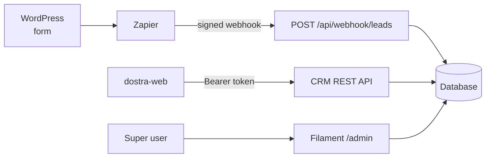
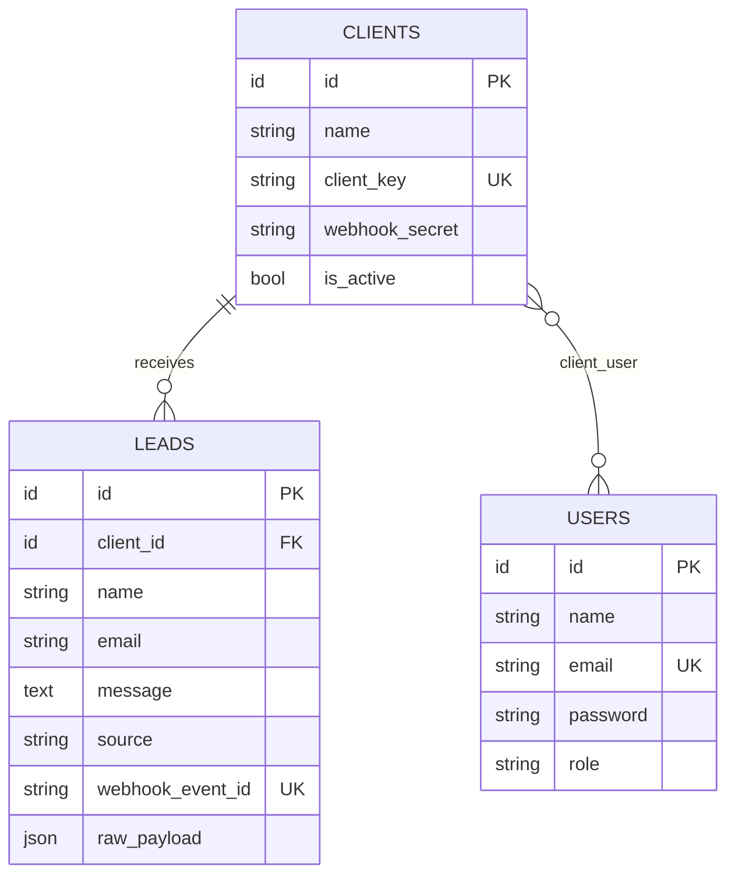

<div align="center">

<br/>

```
██████╗  ██████╗ ███████╗████████╗██████╗  █████╗      █████╗ ██████╗ ██╗
██╔══██╗██╔═══██╗██╔════╝╚══██╔══╝██╔══██╗██╔══██╗    ██╔══██╗██╔══██╗██║
██║  ██║██║   ██║███████╗   ██║   ██████╔╝███████║    ███████║██████╔╝██║
██║  ██║██║   ██║╚════██║   ██║   ██╔══██╗██╔══██║    ██╔══██║██╔═══╝ ██║
██████╔╝╚██████╔╝███████║   ██║   ██║  ██║██║  ██║    ██║  ██║██║     ██║
╚═════╝  ╚═════╝ ╚══════╝   ╚═╝   ╚═╝  ╚═╝╚═╝  ╚═╝    ╚═╝  ╚═╝╚═╝     ╚═╝
```

*Lead ingestion, CRM REST API and admin panel for the Dostra system*

<br/>

[](https://laravel.com/)
[](https://www.php.net/)
[](https://filamentphp.com/)
[](https://laravel.com/docs/sanctum)
[](https://www.postgresql.org/)
[](https://sqlite.org/)
[](https://pestphp.com/)

<br/>

[Overview](#-overview) ·
[Quick start](#-quick-start) ·
[Auth](#-authentication) ·
[Endpoints](#-endpoints) ·
[Data model](#-data-model) ·
[Testing](#-testing) ·
[Production](#-production)

</div>

---

## ✨ Overview

`dostra-api` is the Laravel 13 backend for Dostra. It does two jobs:

1. **📥 Webhook ingestion.** Receives HMAC-signed leads from WordPress/WPForms via Zapier, verifies every request, and stores the lead under the right client.
2. **📊 CRM backend.** Serves a token-authenticated REST API to the [`dostra-web`](https://github.com/chetannagar/dostra-web) dashboard, plus a Filament admin panel for super users.

It is API-only. There is no frontend build pipeline here.

> This service is normally run through [`dostra-deploy`](https://github.com/chetannagar/dostra-deploy), which wires it to the frontend, PostgreSQL and Nginx.



---

## 🔐 Access model

| Role | Clients | Users | Leads | Filament `/admin` |
|------|---------|-------|-------|:-----------------:|
| `super_user` | All (create, edit) | All (create, edit) | All | ✅ |
| `admin` | All (create, edit) | All (create, edit) | All | ❌ |
| `client` | Assigned only (read) | ❌ | Assigned clients only (read) | ❌ |

- `super_user` and `admin` are both treated as admin by the API (`User::isAdmin()`). Only `super_user` passes `canAccessPanel()` for Filament.
- Admin-level users are never assigned clients. Saving one clears its assignments.
- Enforced in three layers: Sanctum auth, Laravel Policies, and scoped Eloquent queries.
- Leads are read-only through the API. They are created only by the webhook.

---

## 🚀 Quick start

### With Docker (recommended)

Use the deploy repo. It starts the API with PostgreSQL and the frontend, with hot reload:

```bash
cd ..                        # dostra-deploy root
./scripts/docker-deploy.sh   # API on http://127.0.0.1:8000
```

### Without Docker

You need **PHP 8.5.12+** (or 8.4.27+) with the `intl`, `zip`, `bcmath` and database extensions, plus Composer.

```bash
composer install
cp .env.example .env
php artisan key:generate
```

Then pick a database in `.env`.

<details>
<summary><strong>Option A: SQLite (zero setup)</strong></summary>

<br/>

```bash
touch database/database.sqlite
```

```env
DB_CONNECTION=sqlite
DB_DATABASE=database/database.sqlite
```

</details>

<details>
<summary><strong>Option B: PostgreSQL (the default in <code>.env.example</code>)</strong></summary>

<br/>

```env
DB_CONNECTION=pgsql
DB_HOST=localhost
DB_PORT=5432
DB_DATABASE=dostra_test_db
DB_USERNAME=your_username
DB_PASSWORD=your_password
```

</details>

Then migrate, seed and serve:

```bash
php artisan migrate --seed
php artisan serve            # or: composer run dev
```

API: `http://127.0.0.1:8000` · Admin panel: `http://127.0.0.1:8000/admin` · Health check: `/up`

### 🌱 Seed data (local only)

| Role | Email | Password |
|------|-------|----------|
| `super_user` | `superuser@example.com` | `password` |
| `admin` | `admin@example.com` | `password` |
| `client` | `client@example.com` | `password` (assigned to `client_1`) |
| `client` | `client2@example.com` | `password` (assigned to `client_2`) |

Two clients are seeded for webhook testing:

| `client_key` | `webhook_secret` |
|--------------|------------------|
| `client_1` | `super-secret-test-key-123` |
| `client_2` | `super-secret-test-key-456` |

> ⚠️ **Never seed these in production.** Production creates users by hand. See [Production](#-production).

---

## 🔑 Authentication

### CRM login (Sanctum personal access tokens)

```http
POST /api/login
Content-Type: application/json
```

```json
{ "email": "admin@example.com", "password": "password" }
```

```json
{
  "token": "plain-text-token",
  "user": {
    "id": 2,
    "name": "Admin User",
    "email": "admin@example.com",
    "role": "admin",
    "clients": []
  }
}
```

Send the token on every other request:

```http
Authorization: Bearer <token>
Accept: application/json
```

| Status | Meaning |
|--------|---------|
| `422` | Wrong credentials (`Invalid credentials.`) or malformed input |
| `429` | More than 5 attempts a minute for this email + IP |
| `401` | Missing, invalid or revoked token on a protected route |

### Webhook signing (Zapier → API)

Webhook calls don't use bearer tokens. Each request carries four headers and an HMAC signature:

```http
X-Client-Key:         wp_acme_plumbing
X-Webhook-Id:         evt_abc123
X-Webhook-Timestamp:  1711770000
X-Webhook-Signature:  <hex hmac>
```

```php
$signature = hash_hmac('sha256', $timestamp.'.'.$rawJsonBody, $client->webhook_secret);
```

The middleware (`validate.lead.webhook`) checks, in order:

| # | Check | Failure |
|---|-------|---------|
| 1 | All four headers present | `401 Missing webhook authentication headers.` |
| 2 | Client exists **and is active** | `401 Invalid webhook client.` |
| 3 | Timestamp is digits only | `401 Invalid webhook timestamp.` |
| 4 | Timestamp within ±5 minutes | `401 Webhook timestamp is too old.` |
| 5 | Signature matches (constant-time compare) | `401 Invalid webhook signature.` |
| 6 | `X-Webhook-Id` not seen before | `200` with the existing lead, nothing created |

The webhook route is exempt from CSRF protection. Full Zapier setup: [`dostra-deploy/docs/ZAPIER-INTEGRATION.md`](https://github.com/chetannagar/dostra-deploy/blob/master/docs/ZAPIER-INTEGRATION.md).

---

## 📡 Endpoints

All routes live under `/api`.

### Public

| Method | Endpoint | Throttle | Description |
|--------|----------|----------|-------------|
| `POST` | `/webhook/leads` | 60/min per client key | Ingest a signed lead |
| `POST` | `/login` | 5/min per email + IP | Exchange credentials for a token |

<details>
<summary><strong><code>POST /api/webhook/leads</code> example</strong></summary>

<br/>

**Body** (all fields optional):

```json
{
  "name": "John Smith",
  "email": "john@example.com",
  "message": "Need a quote"
}
```

| Field | Rules |
|-------|-------|
| `name` | string, max 255 |
| `email` | valid email, max 255 |
| `message` | string |

**`201 Created`**

```json
{
  "message": "Lead received successfully",
  "data": {
    "id": 1,
    "client_id": 1,
    "name": "John Smith",
    "email": "john@example.com",
    "message": "Need a quote",
    "source": "wpforms-zapier",
    "raw_payload": { "name": "John Smith", "email": "john@example.com", "message": "Need a quote" },
    "client": { "id": 1, "name": "Client 1", "client_key": "client_1", "is_active": true },
    "created_at": "2026-03-31T00:00:00.000000Z",
    "updated_at": "2026-03-31T00:00:00.000000Z"
  }
}
```

**`200 OK`** for a repeated `X-Webhook-Id`: the same shape with `"message": "Webhook event already processed."`.

</details>

### Authenticated (`auth:sanctum`, 120/min per user)

#### Session

| Method | Endpoint | Access | Description |
|--------|----------|--------|-------------|
| `GET` | `/me` | All | Current user with assigned clients |
| `POST` | `/logout` | All | Revoke the current token |

#### Clients

| Method | Endpoint | Access | Description |
|--------|----------|--------|-------------|
| `GET` | `/clients` | Admin: all · Client: assigned | List clients |
| `POST` | `/clients` | Admin | Create a client |
| `GET` | `/clients/{client}` | Admin: any · Client: assigned | Show a client |
| `PUT` | `/clients/{client}` | Admin | Update a client |
| `POST` | `/clients/{client}/rotate-webhook-secret` | Admin | Generate a new secret and return it |

<details>
<summary><strong>Create / update client</strong></summary>

<br/>

```json
{
  "name": "Acme Plumbing",
  "client_key": "wp_acme_plumbing",
  "webhook_secret": "optional, min 32 chars",
  "is_active": true
}
```

- `name` is required on create and must be unique.
- `client_key` is optional. If omitted it's generated as `wp_{snake_case_name}` (e.g. `wp_acme_plumbing`). It must be unique.
- `webhook_secret` is optional. If omitted, a 64-character random string is generated.
- The secret is **never returned** by the client endpoints. The only way to read one is the rotate endpoint, which returns the new value once.

```json
{
  "message": "Webhook secret rotated successfully.",
  "data": { "id": 1, "name": "Acme Plumbing", "client_key": "wp_acme_plumbing", "webhook_secret": "…64 chars…" }
}
```

</details>

#### Users

| Method | Endpoint | Access | Description |
|--------|----------|--------|-------------|
| `GET` | `/users` | Admin | List users with their clients |
| `POST` | `/users` | Admin | Create a user |
| `GET` | `/users/{user}` | Admin | Show a user |
| `PUT` | `/users/{user}` | Admin | Update a user, role or client assignments |

<details>
<summary><strong>Create / update user</strong></summary>

<br/>

```json
{
  "name": "Client User",
  "email": "client@example.com",
  "password": "password123",
  "role": "client",
  "client_ids": [1]
}
```

- `role` is one of `super_user`, `admin`, `client`.
- `password` needs at least 8 characters. `email` must be unique.
- `client_ids` replaces the user's assigned clients. It's ignored (and cleared) for `admin` and `super_user`.
- On update every field is optional.

</details>

#### Leads

| Method | Endpoint | Access | Description |
|--------|----------|--------|-------------|
| `GET` | `/leads` | Admin: all · Client: assigned | Paginated list, newest first |
| `GET` | `/leads/{lead}` | Admin: any · Client: assigned | Show a lead |

| Query param | Rule | Effect |
|-------------|------|--------|
| `client_id` | existing client id | Only that client's leads |
| `email` | string | Exact email match |
| `search` | string, max 255 | Substring match on name, email or message |
| `from` / `to` | dates, `to ≥ from` | Filter by creation date (inclusive) |
| `per_page` | 1 to 100 (default 15) | Page size |
| `page` | integer | Page number |

```text
GET /api/leads?client_id=1&search=quote&from=2026-03-01&to=2026-03-31&per_page=25
```

The response is a Laravel paginated resource collection: `data`, `links` and `meta` (`current_page`, `last_page`, `per_page`, `total`, …).

---

## 🗄 Data model



- Deleting a client cascades to its leads and assignments.
- `webhook_event_id` is unique, which is what makes ingestion idempotent.
- `raw_payload` keeps the full JSON body that was received.

---

## 🛠 Admin panel (Filament)

`/admin` is a Filament v5 panel ("Dostra Admin") for **super users only**. It provides:

- **Clients:** create, edit, delete, activate or deactivate, and manage webhook credentials.
- **Users:** create and edit, set roles, assign clients.
- **Leads:** browse and inspect.

Authentication uses Laravel's normal session, separate from API tokens.

---

## 🧱 Project structure

```
app/
├── Filament/Resources/        # Clients, Users, Leads admin resources
├── Http/
│   ├── Controllers/           # Auth, Client, ClientWebhookSecret, Lead, User, Webhook
│   ├── Middleware/            # ValidateLeadWebhookSignature
│   ├── Requests/              # Form Requests: all validation lives here
│   └── Resources/             # API Resources: all JSON shapes live here
├── Models/                    # Client, Lead, User
├── Policies/                  # ClientPolicy, LeadPolicy, UserPolicy
└── Providers/                 # Rate limiters, Filament panel
bootstrap/app.php              # routing, proxy trust, PHP version guard
database/                      # migrations, seeders
docker/entrypoint.prod.sh      # production startup
routes/api.php                 # every API route
tests/                         # Pest feature tests
```

---

## 🧪 Testing

```bash
php artisan test --compact                       # full suite
php artisan test --compact --filter=Webhook      # subset
vendor/bin/pint --dirty --format agent           # format changed PHP files
```

The suite uses in-memory SQLite (set in `phpunit.xml`) and currently has **63 passing tests**:

| Area | Covered |
|------|---------|
| Auth | login, `/me`, logout, token behaviour |
| Access control | clients, users, leads, per role |
| Webhook | signing, timestamps, inactive clients, idempotency |
| Lead listing | filters, search, pagination |
| Secrets | rotation |
| Platform | rate limits, trusted proxies, Filament access |

> **Tests fail with `could not translate host name "db"`?** A stale config cache from a Docker run is overriding `phpunit.xml`. Run `php artisan config:clear`.

Conventions for contributors: Form Requests for validation, API Resources for responses, `php artisan make:` for scaffolding, `config()` rather than `env()` outside config files, `Model::query()` over `DB::`, and a Pest test for every change.

---

## 🏭 Production

Build with `Dockerfile.prod` (PHP 8.5.12 FPM, Alpine, non-root `www-data`, no dev dependencies). Behind Nginx it runs as part of the deploy repo's production stack:

```bash
cd ..   # dostra-deploy
./scripts/docker-deploy-prod.sh
```

On start, `docker/entrypoint.prod.sh`:

1. `php artisan optimize` (caches config, routes, events and views using the real environment)
2. `php artisan migrate --force --isolated` (skip with `RUN_MIGRATIONS=false`)
3. `exec php-fpm`

Notes:

- **PHP is version-guarded.** `composer.json` requires `~8.4.27 || ^8.5.12`, and `bootstrap/app.php` refuses to boot on older patch levels because of two critical PHP security bugs.
- **Proxies are trusted** (`trustProxies(at: '*')`) because PHP-FPM is only reachable from Nginx. Don't expose port 9000 publicly.
- **Production never seeds users.** Create the first `super_user` by hand:

  ```bash
  docker exec -it dostra-api-prod php artisan tinker
  ```

  ```php
  App\Models\User::create(['name' => 'You', 'email' => 'you@example.com', 'password' => 'strong-password', 'role' => 'super_user']);
  ```

- **Cache and locks:** production uses `CACHE_STORE=file`, which is fine for one container. Use Redis if you run several replicas.
- Logs go to `stderr`. Read them with `docker logs dostra-api-prod`.

Full guide: [`dostra-deploy/docs/DEPLOY.md`](https://github.com/chetannagar/dostra-deploy/blob/master/docs/DEPLOY.md).

---

## ⚙️ Environment

| Variable | Notes |
|----------|-------|
| `APP_KEY` | Required. Generate with `php artisan key:generate`. |
| `APP_URL` | Public URL of the app |
| `DB_CONNECTION` | `pgsql` (default in `.env.example`) or `sqlite` |
| `DB_HOST` · `DB_PORT` · `DB_DATABASE` · `DB_USERNAME` · `DB_PASSWORD` | PostgreSQL connection |
| `SESSION_DRIVER` · `QUEUE_CONNECTION` · `CACHE_STORE` | `database` by default; `CACHE_STORE=file` in production |

---

## 📄 License

Internal use only. Add a licence file if this becomes public.

---

<div align="center">
<sub>Built with Laravel · Filament · Sanctum · Pest</sub>
</div>
